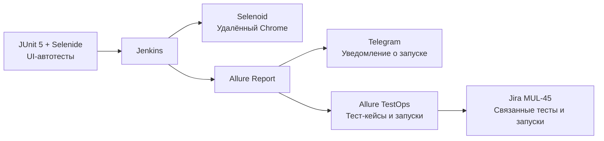

<h1 align="center">Автотесты для Tutu.ru</h1>

<h2 align="center">Учебный проект с UI-автотестами для сайта <a href="https://www.tutu.ru/">Tutu.ru</a>. Тесты написаны на Java с использованием Selenide и JUnit 5.</h2>

<p align="center">
  <a href="https://www.tutu.ru/"></a>
</p>

## Схема проекта



Тесты организованы по паттерну Page Object: сценарии находятся в `TutuTests`, а действия и проверки страницы - в `pages/MainPage`, `HelpPage`, `HelpArticlePage`, `GuidePage`, `TrainsPage` и компоненте `components/TrainSearchForm`.

## Технологии

<p align="left">
  <a href="https://www.oracle.com/java/"></a>
  <a href="https://gradle.org/"></a>
  <a href="https://junit.org/junit5/"></a>
  <a href="https://selenide.org/"></a>
  <a href="https://allurereport.org/"></a>
  <a href="https://www.jenkins.io/"></a>
  <a href="https://allurereport.org/allure-testops/"></a>
  <a href="https://www.atlassian.com/software/jira"></a>
</p>

## Тест-кейсы

| № | Тест-кейс | Что проверяется |
| --- | --- | --- |
| 1 | Главная страница | Одна общая smoke-проверка шапки, логотипа, формы, входа, description и футера |
| 2 | Обмен городов | Выбрать Москву и Санкт-Петербург из подсказок, поменять местами, проверить оба поля |
| 3 | Повторный обмен | Дважды поменять выбранные города, проверить восстановление маршрута |
| 4 | Пассажиры | Добавить взрослого, проверить 2 пассажиров, убрать и проверить возврат к 1 |
| 5 | Поиск поездов | Заполнить маршрут, нажать поиск, перейти к результатам, проверить маршрут и непустое расписание |
| 6 | Справочная | С главной перейти в справочную, выбрать поезда, открыть инструкцию возврата |
| 7 | Путеводитель | С главной перейти в путеводитель, раскрыть все регионы и найти Татарстан |

## Особенности реализации

- Для каждого действия в Allure добавлены понятные шаги через `@Step` и `AllureSelenide`.
- Для элементов с несколькими вариантами разметки выбирается видимый экземпляр через `$$().findBy(visible)`.
- Проверки URL и заголовка ожидают нужное состояние страницы; локаторы находятся в Page Object.
- К Allure прикладываются скриншот, HTML и доступные логи браузера. Видео добавляется при удалённом запуске; браузер закрывается даже при ошибке сбора вложений.

## Запуск

Требуются JDK 17+ и Chrome. Gradle Wrapper включён в репозиторий.

Локальный запуск:

```bash
./gradlew clean test
./gradlew test -Dheadless=true
```

В Jenkins тесты запускаются в удалённом Chrome через Selenoid. После выполнения Jenkins публикует Allure Report.

Параметры запуска:

| Параметр | По умолчанию | Назначение |
| --- | --- | --- |
| `browser` | `chrome` | Браузер |
| `browserVersion` | Пусто | Установленный локально браузер или версия на удалённом сервере |
| `browserSize` | `1920x1080` | Размер окна |
| `baseUrl` | `https://www.tutu.ru/` | Сайт |
| `remote` | Не задан | URL Selenoid |
| `headless` | `false` | Запуск без окна |
| `videoUrl` | `https://selenoid.qa.guru/video/` | Базовый URL видеозаписей |

```bash
./gradlew test -Dremote=http://localhost:4444/wd/hub -DbrowserVersion=128.0
./gradlew allureReport
```

Версию браузера нужно выбирать из доступных на вашем сервере Selenoid.
Отчёты JUnit: `build/reports/tests/test/index.html`, Allure results: `build/allure-results`.

Ожидание элементов — 15 секунд, загрузки страницы — 60 секунд. При необходимости
переопределяются через `-Dselenide.timeout` и `-Dselenide.pageLoadTimeout` (миллисекунды).

## Проверка после доработки

14.11.2026: все **7 сценариев** проверены в локальном headless Chrome 157.
После исправлений падения перепроверялись адресными запусками; это результаты нескольких
запусков, а не новый Jenkins-прогон. Новый набор ещё не опубликован в GitHub.

```bash
./gradlew test -Dheadless=true
```

## Ручное тестирование

[Тест-кейсы Tutu.ru](docs/manual-test-cases.md) дополняют автоматический smoke-набор
проверками формы поиска, авторизации и навигации. Покупка и оплата билетов не выполняются.

## Результаты предыдущего прогона

Архивный результат **предыдущей версии набора (10 статичных проверок)**: в [прогоне Jenkins №22](https://jenkins.qa.guru/job/tutu/22/allure/#suites/9d9746198fda9b3d1f038c735e93d3e4) успешно выполнены все 10 автотестов.

| Всего тестов | Успешно | Процент прохождения | Длительность |
| --- | --- | --- | --- |
| 10 | 10 | 100 % | 00:01:47 |

### Jenkins

Тесты запускаются в [Jenkins job `tutu`](https://jenkins.qa.guru/job/tutu/). Jenkins собирает проект из GitHub, запускает тесты в Selenoid и публикует артефакты Allure Report и Allure TestOps.


### Allure Report

Allure-отчёт содержит общую статистику, историю запусков, список тестов и детализацию каждого сценария с шагами выполнения и вложениями.


### Видео прохождения теста

Запись удалённого запуска сценария «На главной странице видна форма поиска» в Chrome через Selenoid.


[Открыть видео в формате MP4](docs/images/search-form-test-run.mp4)

## Интеграции

### Telegram

После завершения прогона настроено автоматическое Telegram-уведомление: оно содержит круговую диаграмму, число пройденных тестов, длительность и ссылку на Allure Report.


### Allure TestOps

Для проверки преподавателем владельцу нужно предоставить доступ к проекту в настройках Allure TestOps. Локальные изменения кода не меняют приватность проекта. Скриншот ниже относится к прежним 10 тест-кейсам; после публикации нового набора потребуется новый запуск Jenkins.

Проект интегрирован с [Allure TestOps](https://allure.qa.guru/project/5371/dashboards). На дашборде заведены 10 активных тест-кейсов, и все 10 отмечены как автоматизированные.


### Jira

Настроена интеграция Jira и Allure TestOps. В [задаче MUL-45](https://jira.qa.guru/browse/MUL-45) отображаются связанные автотесты и результаты их запусков, поэтому статус разработки и результаты тестирования доступны в одной задаче.

## Автор

**Фатыхова Рената Рашидовна**
Auto QA

### Контакты для связи

- Email: [renata.musenova@gmail.com](mailto:renata.musenova@gmail.com)
- Телефон: [+7 917 240-33-84](tel:+79172403384)

- Telegram: [@renata_fatykhov](https://t.me/renata_fatykhov)
